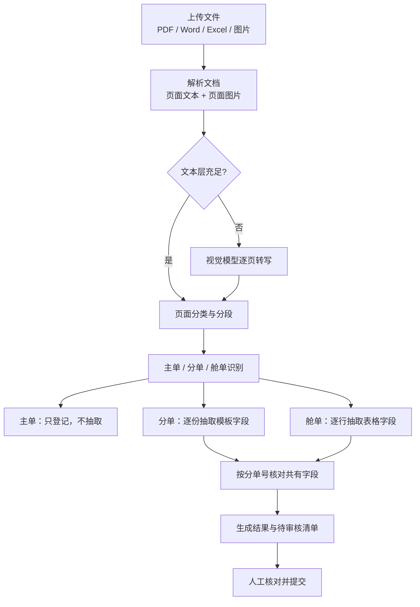

# DocMind DZ

航空货运单证（主单 / 分单 / 舱单）字段抽取与一致性核对服务：识别并跳过主单，逐份抽取分单与舱单，按分单号核对共有字段，输出待人工审核的差异清单。

## 技术栈

- **后端**：Python 3.12+、FastAPI、Uvicorn、LangGraph、LangChain（OpenAI 兼容接口）、Pydantic v2
- **文档解析**：PyMuPDF（PDF 文本层与页面渲染）、python-docx、openpyxl / xlrd
- **前端**：原生 HTML + CSS + ES Modules，无构建步骤
- **存储**：本地文件（`data/` 下 JSON，无数据库）
- **工具**：uv、pytest、ruff

## 工作流程



## 运行方式

```bash
uv sync
cp .env.example .env          # Windows: copy .env.example .env
# 在 .env 中填入 DOCMIND_DZ_MODEL_API_KEY
uv run python main.py         # http://127.0.0.1:8010
```

没有模型密钥时可用固定样例跑通界面与流程：

```bash
# .env 中设置
DOCMIND_DZ_MOCK_LLM=true
```

测试与冒烟验证：

```bash
uv run pytest
uv run python tools/smoke_test.py --base http://127.0.0.1:8010
```

## 目录结构

```text
DocMind_DZ/
├─ main.py                     # 启动入口
├─ pyproject.toml              # 依赖与工具配置
├─ .env.example                # 环境变量样例
├─ app/
│  ├─ main.py                  # FastAPI 装配、静态资源托管
│  ├─ config.py                # 配置（DOCMIND_DZ_ 前缀）
│  ├─ agent/                   # 模型网关：provider、重试与兜底、JSON 解析、mock
│  ├─ api/routes/analysis.py   # 任务接口：上传、进度 SSE、结果、暂停/继续/取消、提交
│  ├─ collector/               # 多格式解析器、页面分类与分段规则
│  ├─ prompts/                 # 抽取提示词模板
│  ├─ schemas/                 # 字段定义、领域模型、提交模型
│  ├─ service/                 # 管线节点、字段抽取、一致性核对、审核清单、任务生命周期
│  ├─ storage/file_store.py    # data/ 目录契约与原子读写
│  ├─ workflow/                # LangGraph 图、节点包装、状态与中断异常
│  └─ static/                  # 前端：index.html / styles.css / ES Modules
├─ tests/                      # 单元与管线测试
├─ tools/smoke_test.py         # 冒烟测试脚本
└─ data/                       # 运行产物（tasks/、results/，已 gitignore）
```
