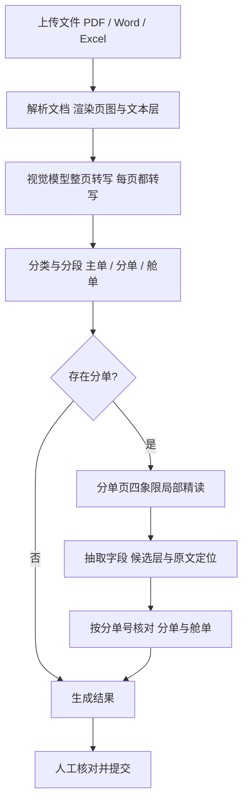

# DocMind DZ

航空货运单证（主单 / 分单 / 舱单）字段抽取与一致性核对服务：所有页面统一走视觉模型转写，识别并跳过主单，逐份抽取分单与舱单，按分单号核对共有字段，输出字段级候选与待人工审核的差异清单。

## 技术栈

- **后端**：Python 3.12+、FastAPI、Uvicorn、LangGraph、LangChain（OpenAI 兼容接口）、Pydantic v2
- **文档解析**：PyMuPDF（页面渲染 + 文本层定位）、python-docx、openpyxl / xlrd、LibreOffice（Office 转 PDF）
- **前端**：原生 HTML + CSS + ES Modules，无构建步骤
- **存储**：本地文件（`data/` 下 JSON + Markdown，无数据库）
- **工具**：uv、pytest、ruff

## 工作流程



## 关键设计

- **全量 VLM 转写**：不信任 PDF 文本层（扫描件、字体乱码、表格错位），文本层只保留给坐标定位。
- **分单局部精读**：分类后只对分单页做四象限 300dpi 放大转写（横纵各 12% 重叠），抽取时局部优先；切图只在内存传给模型，不落盘。
- **候选层**：36 个字段全部输出候选（value / status / confidence / evidence.quote），抽不到也补 missing；模型逐字引用原文，后端校验 quote 是否出现在转写文本中，对不上只降级为待审核、不丢值。
- **字段定位**：先用引用找锚点，再取同栏同行的值；同名值多处命中时用同栏约束消歧，无法确定就不框（宁可不框，也不框错）。
- **港口三字码**：`data/reference_cache/hbinfo.json`（6394 条）是唯一来源，模型输出三字码、后端查表校验；多义城市保留原文进待审核；前端只能从下拉候选中选。
- **Office 宽表**：Excel 转换前设置 fitToWidth=1 / fitToHeight=0，先缩到一页宽、放不下再上下分页；`.xls` 先转 xlsx 再套同一逻辑。
- **思考开关**：识图转写关思考（逐字转写不需要推理，更快且准确率差异很小），字段抽取与分类开思考。
- **品名清洗**：品名栏里的 HS CODE、发票号、P.O. 等附加行会被确定性剔除。
- **主单判定**：必须能读到主单号才算主单，运单条款页不会再被误判成主单。

## 数据层产物

```text
data/
├─ reference_cache/hbinfo.json   # 港口三字码主数据（唯一来源）
├─ tasks/<task_id>/
│  ├─ <source>.pdf               # 原件
│  ├─ src01/page_00N.png        # 渲染页图（送模型的原图）
│  ├─ transcription/page_00N.md # 整页 VLM 转写（正文唯一来源）
│  ├─ transcription/page_00N_zoom.md  # 分单四象限局部精读
│  ├─ document.json             # 页面元数据 + 分段 + 主单登记
│  ├─ candidates.json           # 字段候选唯一来源
│  ├─ documents.json            # 分单字段与定位 + 舱单
│  ├─ comparisons.json          # 核对结果（断点依据）
│  └─ task_status.json / process.log
└─ results/<task_id>.json        # 最终交付物（前端 /result）
```

## 运行方式

```bash
uv sync
cp .env.example .env          # Windows: copy .env.example .env
# 在 .env 中填入 DOCMIND_DZ_MODEL_API_KEY
uv run python main.py         # http://127.0.0.1:8010
```

需要真实模型密钥；仓库不再提供 mock 模式，测试通过 `tests/fake_gateway.py` 注入假网关离线跑通管线。

```bash
uv run pytest
uv run python tools/smoke_test.py --base http://127.0.0.1:8010
```

## 目录结构

```text
DocMind_DZ/
├─ main.py                     # 启动入口
├─ pyproject.toml              # 依赖与工具配置
├─ .env.example                # 环境变量样例
├─ app/
│  ├─ main.py                  # FastAPI 装配、静态资源托管、健康检查
│  ├─ config.py                # 配置（DOCMIND_DZ_ 前缀）
│  ├─ agent/                   # 模型网关：provider、重试与兜底、JSON 解析
│  ├─ api/routes/analysis.py   # 任务接口：上传、进度 SSE、结果、港口搜索、提交
│  ├─ collector/               # 多格式解析器、页面分类与分段、字段定位、港口主数据索引
│  ├─ prompts/                 # 转写 / 分类 / 局部精读 / 抽取提示词
│  ├─ schemas/                 # 字段定义、领域模型、提交模型
│  ├─ service/                 # 管线节点、字段抽取、一致性核对、审核清单、港口口径
│  ├─ storage/                 # file_store 目录契约 + task_docs 统一文档模型
│  ├─ workflow/                # LangGraph 图、节点包装、状态与中断异常
│  └─ static/                  # 前端：index.html / styles.css / ES Modules
├─ tests/                      # 单元与管线测试（含假网关 tests/fake_gateway.py）
├─ tools/smoke_test.py         # 冒烟测试脚本
└─ data/                       # 运行产物（tasks/、results/、reference_cache/，已 gitignore）
```

## 常用配置

| 环境变量 | 默认 | 说明 |
|---|---|---|
| `DOCMIND_DZ_MODEL_API_KEY` | - | 模型密钥（必填） |
| `DOCMIND_DZ_MODEL_THINKING` | true | 字段抽取 / 分类是否开思考 |
| `DOCMIND_DZ_MODEL_VISION_THINKING` | false | 识图转写建议关（更快） |
| `DOCMIND_DZ_MODEL_TIMEOUT_SECONDS` | 300 | 文本调用超时（开思考后更慢） |
| `DOCMIND_DZ_MODEL_VISION_TIMEOUT_SECONDS` | 120 | 视觉调用超时 |
| `DOCMIND_DZ_VISION_PAGE_CONCURRENCY` | 2 | 整页转写并发页数 |
| `DOCMIND_DZ_HOUSE_BILL_CONCURRENCY` | 3 | 分单抽取并发数 |
| `DOCMIND_DZ_OFFICE_CONCURRENCY` | 1 | Office 转 PDF 并发数 |
